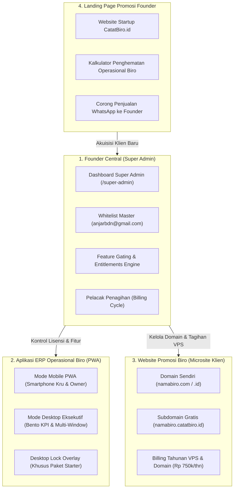

# CatatBiro Wisata — Enterprise Startup & Multi-Tenant Ecosystem Architecture

> **Dokumen Resmi Arsitektur & Logika Bisnis**  
> **Master Founder & Super Admin**: `anjarbdn@gmail.com`  
> **Versi**: 2.0 (Enterprise Ready)  
> **Tujuan**: Menghindari halusinasi AI, menjadi panduan baku bagi pengembang & agent coding, serta mendokumentasikan model bisnis SaaS end-to-end.

---

## 1. Peta Ekosistem Startup (4 Pilar Terintegrasi)

---

## 2. Model Bisnis & Matriks Tiering Lisensi (Feature Gating)

### Strategi Monetisasi Dual-Phase:
1. **Fase Saat Ini (Penetrasi Pasar)**:
   - **Model Sekali Bayar (Lifetime Deal)** untuk aplikasi catat biro.
   - Pilihan Paket:
     - **Paket Starter (Murah)**: Akses hanya di smartphone (PWA Mobile). Mode desktop di laptop/PC terkunci oleh overlay profesional dengan tombol upgrade. Maksimal 5 trip aktif, 2 kru, dan laporan PDF memiliki watermark aplikasi.
     - **Paket Pro (Standar)**: Membuka penuh Mode Desktop Eksekutif (Bento KPI), laporan PDF bersih tanpa watermark (Kop Surat Biro Sendiri), maksimal 30 trip aktif, 10 kru, dan audit session login.
   - **Layanan Website Promosi Biro (Add-on)**: Dikenakan biaya perpanjangan **tahunan (atau per 3/6 bulan)** sebesar Rp 750.000/tahun untuk menutupi biaya sewa domain (`.com`/`.id`) dan server hosting/VPS.
2. **Fase Tahun Depan (Skala Startup Enterprise)**:
   - Transisi ke **Langganan Bulanan (Monthly SaaS)** dan Tahunan.
   - Fitur Enterprise: Multi-cabang (branch), AI Asisten Wisata kuota prioritas, integrasi website promosi otomatis, dan API akses.

---

## 3. Matriks Entitlements (Kunci Pembatasan Fitur)

| Fitur Aplikasi | Tier Starter (Sekali Bayar Murah) | Tier Pro (Sekali Bayar Standar) | Tier Enterprise (SaaS Bulanan) |
| :--- | :--- | :--- | :--- |
| **Akses Mode Desktop di Laptop/PC** | ❌ **Terkunci Overlay Upgrade** | ✅ **Terbuka Penuh (Bento KPI)** | ✅ **Terbuka Penuh + Multi Monitor** |
| **Aplikasi Mobile (PWA Smartphone)** | ✅ Terbuka Penuh | ✅ Terbuka Penuh | ✅ Terbuka Penuh |
| **Batas Kuota Trip Aktif** | 5 Trip / Bulan | 30 Trip / Bulan | ♾️ **Tanpa Batas** |
| **Batas Personel Kru** | 2 Orang Kru | 10 Orang Kru | ♾️ **Tanpa Batas** |
| **Laporan & Kwitansi PDF** | Footer Watermark *"CatatBiro"* | ✅ Bersih (Kop Surat Biro) | ✅ Custom Template + Digital Sign |
| **Asisten AI Gemini** | ❌ Dinonaktifkan | ✅ Kuota Standar Biro | ✅ Kuota Prioritas / Custom Key |
| **Website Promosi Biro** | Biaya Tahunan Penuh | Diskon Paket Bundling | ✅ Termasuk Paket Langganan |

---

## 4. Sandbox Tester Simulator (Fitur Khusus Founder)

Akun master `anjarbdn@gmail.com` memiliki akses ke **Floating Sandbox Toolbar** di pojok layar:
- 👑 **Mode Super Admin Master**: Membuka seluruh fitur dan rute `/super-admin`.
- 🔒 **Simulasi Klien: Tier Starter**: Mensimulasikan pengalaman klien paket murah (layar laptop otomatis memicu overlay pro).
- ⭐ **Simulasi Klien: Tier Pro**: Mensimulasikan akun standar desktop terbuka.
- 🚀 **Simulasi Klien: Tier Enterprise**: Mensimulasikan akun tertinggi.
- 👤 **Simulasi Kru Lapangan**: Sudut pandang sopir / koordinator lapangan.

---

## 5. Panduan Eksekusi Database Supabase (Untuk Founder)

File migrasi SQL lengkap tersimpan di:
`supabase/migrations/20261105_super_admin_and_licensing.sql`

### Langkah Menjalankan di Supabase:
1. Buka dashboard Supabase Anda: [https://supabase.com/dashboard](https://supabase.com/dashboard).
2. Pilih proyek database **trip-catat-app**.
3. Di bilah menu kiri, klik menu **SQL Editor**.
4. Klik **New Query**.
5. Buka tab `/super-admin` di aplikasi atau salin isi file `supabase/migrations/20261105_super_admin_and_licensing.sql`.
6. Tempelkan seluruh query SQL, lalu klik tombol hijau **Run** (atau tekan `Ctrl + Enter`).
7. Tabel `super_admin_whitelist`, `tenants`, `feature_entitlements`, `tenant_invoices`, dan `client_websites` akan langsung aktif dengan Row Level Security (RLS) aman.
